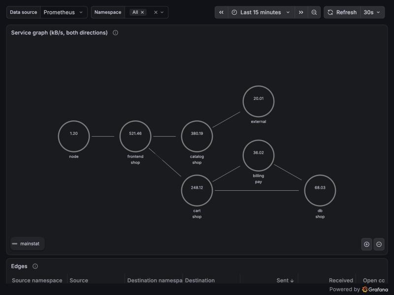

# netflow

An eBPF agent for Kubernetes that reports who talks to whom over TCP, how much, and how healthy the connection is. It runs as a DaemonSet and exposes Prometheus metrics that are shaped for drawing a service graph and for joining with Istio's metrics.

Built for GKE Standard with Dataplane V2 and Istio sidecars. Design details are in [docs/SPEC.md](docs/SPEC.md).

**Status:** the probes are verified on a local kernel. The agent has not yet run on GKE; see the open questions in the spec.

## What you get

For each edge (source workload → destination workload and port):

- bytes in both directions
- connections opened, currently open, and failed connects
- TCP retransmits and round-trip time
- connection lifetime

It sees all TCP traffic on the node, including pods without a sidecar, system namespaces and traffic leaving the cluster. It does not see HTTP requests, UDP or DNS.

## Metrics

All metrics carry the same labels, named like Istio's:

`source_workload_namespace`, `source_workload`, `destination_workload_namespace`, `destination_workload`, `destination_port`

| Metric | Type | Meaning |
|---|---|---|
| `netflow_tcp_sent_bytes_total` | counter | Payload bytes from source to destination |
| `netflow_tcp_received_bytes_total` | counter | Payload bytes from destination back to source |
| `netflow_tcp_retransmits_total` | counter | Segments retransmitted by the observed end |
| `netflow_tcp_connections_opened_total` | counter | Established connections |
| `netflow_tcp_connect_failures_total` | counter | Connects that were refused or timed out |
| `netflow_tcp_connections_open` | gauge | Connections open at the last sample |
| `netflow_tcp_rtt_seconds` | histogram | Smoothed round-trip time, sampled per open connection |
| `netflow_tcp_connection_duration_seconds` | histogram | Lifetime of closed connections |

Workloads that are not pods appear as `external` (outside the cluster), `node` (the host or a host-network pod), or a Service name. Their namespace label is empty for `external` and `node`.

## Build

Requires Docker. The eBPF probe is compiled inside the image build.

```bash
docker build -t REGISTRY/netflow:0.1.0 .
```

```bash
docker push REGISTRY/netflow:0.1.0
```

Build on the architecture of your nodes, or use `docker buildx build --platform linux/amd64,linux/arm64`.

## Deploy

Set the image in [deploy/netflow.yaml](deploy/netflow.yaml), then:

```bash
kubectl apply -f deploy/netflow.yaml
```

```bash
kubectl -n netflow rollout status daemonset/netflow
```

This creates the `netflow` namespace, a service account with read access to pods and services, and the DaemonSet. The pod runs with the `BPF` and `PERFMON` capabilities only.

Check one agent:

```bash
kubectl -n netflow port-forward daemonset/netflow 9090
```

```bash
curl -s localhost:9090/metrics | grep '^netflow_'
```

### Scraping

Each pod serves `/metrics` on port 9090 and carries the `prometheus.io/scrape` and `prometheus.io/port` annotations. If your OpenTelemetry collector does not use annotation discovery, add a scrape job for pods with the label `app=netflow`.

### Flags

| Flag | Default | Meaning |
|---|---|---|
| `-listen` | `:9090` | Address for `/metrics` |
| `-interval` | `15s` | How often open connections are sampled. Keep it at or below the scrape interval. |
| `-no-k8s` | off | Skip the Kubernetes lookup; every address becomes `external`. For testing probes on a dev machine. |

## Queries

These are starting points; they have not been run against real cluster data yet.

Throughput per edge, summed over nodes and ports:

```promql
sum by (source_workload_namespace, source_workload, destination_workload_namespace, destination_workload) (
  rate(netflow_tcp_sent_bytes_total[5m])
)
```

Retransmits per megabyte sent, as a loss indicator:

```promql
sum by (source_workload, destination_workload) (rate(netflow_tcp_retransmits_total[5m]))
/
sum by (source_workload, destination_workload) (rate(netflow_tcp_sent_bytes_total[5m])) * 1e6
```

99th percentile round-trip time per edge:

```promql
histogram_quantile(0.99, sum by (le, source_workload, destination_workload) (rate(netflow_tcp_rtt_seconds_bucket[5m])))
```

Istio request rate next to network round-trip time on the same edge:

```promql
sum by (source_workload, destination_workload) (rate(istio_requests_total{reporter="source"}[5m]))
and on (source_workload, destination_workload)
histogram_quantile(0.5, sum by (le, source_workload, destination_workload) (rate(netflow_tcp_rtt_seconds_bucket[5m])))
```

Edges the agent sees that Istio does not report:

```promql
sum by (source_workload, destination_workload) (rate(netflow_tcp_sent_bytes_total[5m]))
unless on (source_workload, destination_workload)
sum by (source_workload, destination_workload) (rate(istio_tcp_sent_bytes_total[5m]) or rate(istio_requests_total[5m]))
```

## Dashboard

[dashboards/netflow-mesh.json](dashboards/netflow-mesh.json) is an example Grafana dashboard. Import it under Dashboards → New → Import and pick your Prometheus-compatible data source (Mimir works).



| Panel | Shows |
|---|---|
| Service graph | Workloads as nodes, connections as edges, with throughput in kB/s in both directions |
| Edges | One row per edge: bytes each way, open and new connections, failed connects, retransmits, RTT p99, and Istio's request rate and 5xx share |
| Throughput, Retransmits, RTT p99 | The ten busiest edges over time |

The Namespace filter keeps an edge when either end is in a selected namespace.

The dashboard was tested on Grafana 13 with generated sample series, not with data from a real cluster. Two things to know:

- The Node Graph panel ignores units, so the graph query divides by 1000 to show kB/s.
- The Istio columns assume Istio's standard `istio_requests_total` metric with `reporter="source"` in the same data source. They stay empty for edges outside the mesh.

## Troubleshooting

| Symptom | Likely cause |
|---|---|
| Pod fails with `load:` or `attach` errors | Kernel older than 5.11 or without BTF, or a capability was removed from the manifest |
| Pod fails with `kubernetes:` | RBAC missing, or the API server is unreachable from the pod |
| Everything is `external` | The agent runs with `-no-k8s`, or the pod informer has no permissions |
| A meshed workload shows no outbound traffic | Its traffic uses ports excluded from Istio redirection (see limits in the spec) |
| Edges point at Service names | Dataplane V2 leaves the Service IP on the socket (see limits in the spec) |

## How it works

The short version: the kernel already counts bytes, retransmits and round-trip time for every TCP socket. netflow reads those counters at the right moments instead of counting packets itself.

```
kernel                                   agent (one pod per node)
------                                   ------------------------
TCP state change  ── tracepoint ──────►  open / close / failed events
                                                    │
per-socket state (socket storage)                   ▼
        ▲                                 IP → workload (Kubernetes API)
        │ every 15 s                                │
iterator over open sockets ───────────►             ▼
                                          Prometheus metrics on /metrics
```

### In the kernel

- **One tracepoint, `inet_sock_set_state`.** It fires when a TCP socket changes state. The agent acts on three transitions: established (remember the socket), closed (report the final numbers), and closed straight from connecting (a failed connect). All other transitions return immediately.
- **State stored on the socket.** The few values kept per connection (start time, role, last reported counters) live in socket-local storage. The kernel frees it together with the socket, so there is no table to size and nothing to evict.
- **A periodic pass over open sockets.** Every interval the agent runs an eBPF iterator that visits each tracked socket, reads its counters and emits the change since the last visit.
- **Deltas are computed in the kernel.** Every record says "this much since last time", so the agent only adds numbers up and keeps no per-connection state of its own.

### In the agent

- **IP to workload.** The agent watches pods and Services through the Kubernetes API and resolves each address to a namespace and workload name, using the same naming rule as Istio.
- **One socket per connection is counted.** Each connection has two ends, and a sidecar adds two more legs inside the pod. The rules for which one counts are in the [spec](docs/SPEC.md#counting-rules).
- **Aggregation into metrics.** Records are summed per edge and exposed for scraping.

### Why it is built this way

| Choice | Reason |
|---|---|
| Socket layer instead of packet layer | Cost depends on the number of connections, not on throughput. It also stays clear of the tc and XDP hooks, which Dataplane V2's Cilium owns. |
| Read the kernel's counters instead of counting | The TCP stack maintains `bytes_sent`, `bytes_received`, `total_retrans` and `srtt_us` anyway. They are exact, and reading them is nearly free. |
| Tracepoint instead of kprobes | Tracepoints are a stable kernel interface and the cheapest hook type. Kprobes attach to internal functions that can change between kernel versions. |
| Sample open sockets instead of reporting only at close | Envoy pools connections and keeps them open for hours. Close-only reporting would hide most mesh traffic. |
| CO-RE (compile once, run everywhere) | The probe is compiled once at build time, and field offsets are fixed up when it loads. One image works across node kernel versions, and GKE upgrades don't require a rebuild. |
| Attribute by IP instead of by process | Pod IPs are unique in the cluster, so the agent needs neither host PID access nor cgroup parsing, and can run with two capabilities instead of privileged mode. |
| User ID 1337 to recognise Envoy | In a sidecar pod, the app's connection is redirected to Envoy, which opens the real one. Both look like outbound connections from the same pod IP; Istio's fixed proxy user ID tells them apart. |
| Metrics instead of flow logs | Consumers get a standard query API, and storage grows with the number of edges, not the number of connections. |

The approach follows Netflix's Flow Exporter (TCP tracepoints, central attribution by IP) and DoorDash's BPFAgent (Go with `cilium/ebpf`, CO-RE, ring buffer), adapted for a cluster that already runs Cilium and Istio.

## Overhead

Cost depends on the connection rate and the number of open sockets. Throughput does not matter, because nothing is hooked on the packet path.

### Measured

Measured on 2026-11-24 in a Linux VM on an Apple Silicon laptop (kernel 7.2), not on a GKE node, so read these as an order of magnitude. The load was 3,000 short HTTP connections in 37 seconds plus 300 connections held open.

| Part | Measured | Meaning |
|---|---|---|
| Tracepoint | 1.1 µs per call, about 11 calls per connection | About 13 µs of kernel time per connection, both ends included |
| Pass over open sockets | 0.75 µs per open socket | Once per interval |
| Agent process | 0.15 s of CPU over the run | About 0.3% of one core |
| Agent memory | 15 MiB | Without the Kubernetes cache |

### What that means for a node

- 1,000 new connections per second cost roughly 0.7% of one core in the tracepoint.
- 10,000 open connections sampled every 15 seconds cost about 7.5 ms per pass, or 0.05% of one core.
- Memory on a cluster also includes the cache of all pods and Services. This has not been measured; pods are trimmed to a few fields, and the manifest sets a 300 MiB limit.

Very high connection churn (a new connection per request, without pooling) raises CPU linearly. Many distinct edges and ports raise the series count in the metrics store more than the cost on the node.

### Measure it yourself

On a node:

```bash
sysctl kernel.bpf_stats_enabled=1
```

```bash
bpftool prog show
```

`run_time_ns / run_cnt` is the average cost per call. Switch the sysctl off again afterwards.

## Development

See [AGENTS.md](AGENTS.md) for the build loop, the smoke test and the invariants.
